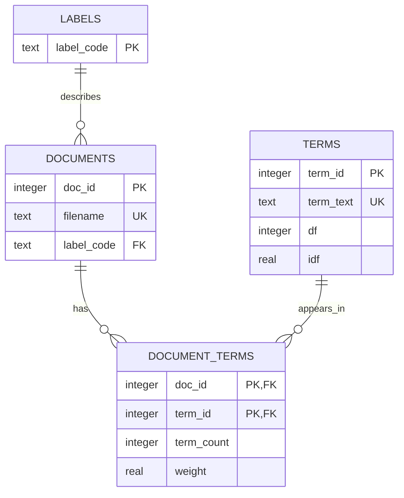
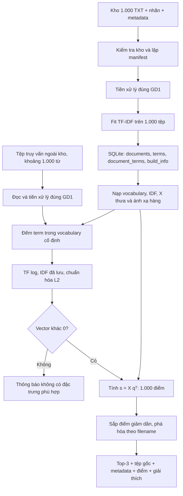

# Kế hoạch GD2 đã chốt: xây dựng CSDL đặc trưng và tìm kiếm văn bản

Ngày lập: 03/11/2026. Chốt triển khai: 04/11/2026. Đây là kế hoạch thực hiện, chưa phải báo cáo kết quả GD2. Phạm vi, lựa chọn kỹ thuật và bộ đánh giá cơ sở dưới đây được chốt cho dự án; số lượng truy vấn và thời lượng là quy ước của nhóm, không phải yêu cầu bổ sung của giảng viên.

## 0. Quyết định triển khai và điểm bắt đầu

**Cập nhật thực hiện 07/11/2026: P2–P7 đã hoàn tất; báo cáo hợp nhất Word/PDF đã được kiểm tra.** P2 dựng đúng ma trận 1.000 × 34.416, có 1.926.766 trọng số khác 0; vocabulary/IDF và top-5 của cả 1.000 tệp khớp đối chiếu GD1. P3 đã tạo `gd2/database/documents.sqlite` với đủ năm bảng, 14 nhãn, 1.000 tài liệu, 34.416 term và 1.926.766 dòng `document_terms`; ma trận đọc lại có sai lệch bằng 0 so với P2, kiểm tra integrity/khóa/df/L2 đều đạt. Xem [Biên bản P2](BIEN_BAN_P2.md), [Biên bản P3](BIEN_BAN_P3.md) và [hướng dẫn chạy](../../gd2/README.md). Kế hoạch này mô tả hiện trạng đã cập nhật; lịch sử khảo sát được lưu riêng. P4 đã có CLI nhận một/nhiều TXT, Top-3, ba bản sao và trace; 18 kiểm thử đạt, vector/điểm khớp tham chiếu. Xem [Biên bản P4](BIEN_BAN_P4.md). P5 đã chốt 12 truy vấn ngoài kho, sáu nhóm, 965–1.025 từ/tệp; kiểm tra ngoài kho và khóa hash đã đạt. Xem [Biên bản P5](BIEN_BAN_P5.md). P6 đã kiểm tra 12.000 điểm và 36 bản sao, có trace Q01, số đo hiệu năng và hai phiếu chấm độc lập. Đã chốt 36 mức liên quan từ hai phiếu và quyết định thống nhất: Mean P@3 = 11,11%, đồng thuận ban đầu 34/36 = 94,44%; 3/12 truy vấn có kết quả mức 2. Xem [Biên bản P6](BIEN_BAN_P6.md). P7 đã hoàn tất báo cáo 40 trang, 30 bảng, 7 hình; nội dung Chương 1–2, công thức và hình gốc được bảo toàn. Xem [Biên bản P7](BIEN_BAN_P7.md) và [Word/PDF hợp nhất](../../gd2/report/README.md).

P0 (mốc dữ liệu/cấu hình) và phần chuẩn bị P1 (metadata, tên tập/phần, đối chiếu các nhóm đã phát hiện) đã hoàn thành. Không tiếp tục mở một đợt rà soát hoặc viết lại GD1 trước khi lập trình. Theo yêu cầu người dùng, các vấn đề diễn đạt GD1 được để lại cho P7 khi soạn báo cáo; chúng không chặn P2–P6.

### Phạm vi đã chốt

| Hạng mục | Quyết định |
|---|---|
| Kho đầu vào | Toàn bộ 1.000 tệp trong `data/corpus`, giữ nội dung và filename theo baseline |
| Phương pháp | Tiền xử lý, Porter, TF-IDF, L2 và cosine đúng GD1; một vector cho mỗi tệp |
| Công nghệ | Python với các phiên bản đã ghi trong baseline; scikit-learn, SciPy; SQLite |
| CSDL | Năm bảng `build_info`, `labels`, `documents`, `terms`, `document_terms`; lưu đủ trọng số khác 0 |
| Chương trình | Chạy bằng dòng lệnh; đọc đặc trưng từ CSDL, nhận TXT truy vấn, trả Top-3 và các tệp kết quả |
| Truy vấn | 12 đoạn liên tục từ 12 tác phẩm ngoài kho, mỗi đoạn 950–1.050 từ trước lọc; khoảng 6 nhóm nội dung |
| Minh họa | Một truy vấn xuyên suốt Q01, một ca kết quả hạn chế trong bộ thử, một ca vector rỗng riêng |
| Đánh giá | Kiểm chứng kỹ thuật; P@3 theo chấm nội dung thủ công; thời gian và dung lượng đo thật |
| Nộp GD2 | Một PDF hợp nhất GD1+GD2, đáp ứng mục 3 và 4a–4c; có số liệu thực nghiệm truy nguyên được |
| Phạm vi để sau | Giao diện demo thuộc GD3; chưa mở rộng thuật toán, kho hoặc số truy vấn vượt bộ cơ sở |

### Các mốc phải hoàn thành theo thứ tự

| Mốc | Công việc thực hiện | Sản phẩm cụ thể | Điều kiện hoàn thành |
|---|---|---|---|
| **P2 — Tái lập đặc trưng** | Đọc cấu hình đã chốt; dùng lại tiền xử lý GD1; tính count, df, IDF, TF-IDF | Module tiền xử lý/dựng đặc trưng; ánh xạ hàng/cột; dữ liệu tham chiếu và biên bản đối chiếu | X có 1.000 × 34.416; hàng khác 0 có norm L2 ≈ 1; df/IDF và term mẫu hợp lý; nếu lệch phải tìm nguyên nhân |
| **P3 — Lưu CSDL** | Tạo schema, nhập metadata và toàn bộ đặc trưng, nạp lại X từ DB | `gd2/database/documents.sqlite`, schema SQL, thống kê CSDL | Đủ 1.000 documents và 34.416 terms; số document_terms bằng nnz(X); khóa hợp lệ; X đọc lại khớp tham chiếu trong sai số ≤ 1e-10 |
| **P4 — Tìm kiếm và xuất trace** | Đọc TXT; transform bằng vocabulary/IDF cố định; tính 1.000 điểm; lấy Top-3 | Module search; kết quả JSON/CSV; ba bản sao TXT; bảng token/trọng số/đóng góp term | Không fit lại trên truy vấn; kết quả đúng thứ tự; trả đúng tệp; xử lý vector rỗng; tổng đóng góp term khớp cosine |
| **P5 — Bộ truy vấn chính thức** | Chọn nguồn ngoài kho, trích đoạn và ghi nguồn/vị trí; chốt danh sách trước xem kết quả | 12 TXT, nguồn trích, query manifest và ghi nhận kiểm tra ngoài kho | Đúng độ dài quy ước; 12 tác phẩm khác nhau; không có tác phẩm nguồn trong kho; không làm thay đổi corpus |
| **P6 — Thực nghiệm** | Chạy toàn bộ truy vấn; phân tích Q01; chấm 36 cặp Top-3; đo thời gian | Trace Q01; kết quả 12 truy vấn; phiếu chấm và P@3; số đo hiệu năng; ca hạn chế | Số liệu lấy từ cùng bản dựng; có bằng chứng nội dung khi chấm; lưu cả kết quả chưa tốt, không tự đặt chỉ số |
| **P7 — Báo cáo hợp nhất** | Viết Chương 3–4 từ bằng chứng; viết lại phần đầu; hoàn thiện hình/bảng và PDF | Bản thảo có thể sửa và PDF GD1+GD2 đã kiểm tra | Có CSDL thực, sơ đồ, I/O, kết quả trung gian, Top-3 và đánh giá; nội dung GD1 được kế thừa; xử lý diễn đạt ở bước này |

P5 có thể chuẩn bị trong khi thực hiện P2–P4, nhưng phải chốt trước khi chạy thực nghiệm P6. Trong P4 có thể dùng đầu vào kiểm thử để kiểm tra chương trình; không dùng điểm của đầu vào đó để chọn truy vấn chính thức theo hướng làm đẹp kết quả. P6 bắt đầu khi P3–P5 đã đạt điều kiện hoàn thành.

### Tổ chức phần mã GD2

Các module P2–P6 đã có, gồm search.py, evaluate.py và benchmark.py; bộ truy vấn chính thức đã khóa ở P5 và chạy tại P6. Không sửa mã GD1 gốc:

```text
gd2/
  src/
    preprocess.py       # xử lý văn bản dùng chung, tương đương GD1
    features.py         # dựng/biểu diễn TF-IDF và ánh xạ
    database.py         # schema, nạp và đọc đặc trưng SQLite
    build_database.py   # điểm vào dựng kho
    search.py           # điểm vào nhận query và trả Top-3
    evaluate.py         # tổng hợp kết quả chấm và thời gian
  config/               # cấu hình lấy từ baseline
  database/             # CSDL bản dựng
  queries/, sources/    # đoạn truy vấn và nguồn ngoài kho
  results/              # điểm, trace, ba TXT đầu ra
  evaluation/           # phiếu chấm, chỉ số và số đo
  report/               # bản soạn, hình và PDF hợp nhất
```

Trước khi sử dụng bản dựng, chạy `python -m gd2.src.verify_database`. P2–P3 đã hoàn tất; không cần dựng lại đặc trưng khi bắt đầu tìm kiếm. Hợp đồng CLI và đầu ra được chốt tại [HOP_DONG_P4.md](HOP_DONG_P4.md).

## 1. Phương án triển khai

Giữ nguyên bộ 1.000 văn bản và toàn bộ phương pháp của GD1. GD2 hiện thực hóa hai nội dung: lưu trữ đặc trưng bằng SQLite; nhận tệp truy vấn tiếng Anh khoảng 1.000 từ, biểu diễn bằng TF-IDF đã cố định và trả về ba tệp có cosine cao nhất. Trọng tâm báo cáo là CSDL thực sự có dữ liệu, đường đi của một truy vấn với số liệu trung gian thật, và đánh giá có tiêu chí rõ ràng.

Không thay thuật toán chính bằng embeddings, BM25, tìm theo nhãn, SVD hoặc tìm theo từng đoạn. Những phương án này làm thay đổi không gian đặc trưng, tập ứng viên hoặc cách tính điểm đã trình bày ở GD1. Cũng chưa cần làm giao diện web, tài khoản hay triển khai lên mạng; đầu ra dòng lệnh đủ để tạo bằng chứng GD2 và là nền cho demo GD3.

Mặc dù chỉ nộp PDF, vẫn cần chạy phần xử lý và CSDL để có kết quả thật. Không nên viết trước các điểm cosine, số bản ghi đặc trưng, thời gian hay độ chính xác rồi mới tìm cách làm chương trình khớp với báo cáo.

## 2. Hiện trạng đã kiểm chứng

| Hạng mục | Hiện trạng | Bằng chứng |
|---|---|---|
| Corpus | 1.000 TXT, 34.344.608 từ; giữ nội dung theo baseline | corpus_manifest.json |
| Metadata | CSV ba cột, đủ 1.000 filename; 14 nhãn | selected_stories.csv, labels.jsonl |
| Đặc trưng | 1.000 × 34.416, nnz = 1.926.766; top-5 khớp GD1 | Biên bản P2 |
| SQLite | Đủ năm bảng; count, trọng số, df/IDF/norm đọc lại khớp P2 | Biên bản P3 và documents.verification.json |
| Mã nguồn | Có tiền xử lý, dựng/kiểm tra đặc trưng, dựng/nạp/kiểm tra SQLite | gd2/src |
| Báo cáo | Giữ nguồn GD1; đã có DOCX và PDF hợp nhất 40 trang, kiểm tra P7 đạt | docs/gd1, gd2/report |
| Tìm kiếm | P4–P6 hoàn tất; đủ thực nghiệm, chấm liên quan và hiệu năng | BIEN_BAN_P4.md, BIEN_BAN_P6.md |

Khảo sát trước triển khai được giữ tại [nhật ký lịch sử](../audit/KHAO_SAT_TRUOC_P2.md). Các số đo hiện hành lấy từ biên bản P2/P3.

## 3. Hợp đồng kế thừa từ GD1

| Thành phần đã chốt | Quy định ở GD2 | Vị trí GD1 |
|---|---|---|
| Dữ liệu tiếng Anh, TXT, 1.000 tệp | Không thay, thêm, bớt hay cắt tệp trong kho chính | 1.1–1.2, trang 6–7 |
| Một vector cho một tệp | Chấm điểm cả tệp; không thay bằng điểm đoạn tốt nhất | 2.1, trang 11 |
| Quy tắc đếm từ | `[a-z]+(?:'[a-z]+)?`, sau chuẩn hóa dấu nháy và chữ thường | 1.2, trang 6 |
| Dấu nháy | Đổi `’`, `‘`, `ʼ` thành `'` | `normalize_text` trong mã GD1 |
| Token đặc trưng | Tách regex; lấy phần trước dấu nháy; loại base dài ≤ 1; lọc từ dừng trước stemming | `content_tokens` và 2.2 |
| Từ dừng | `sklearn.feature_extraction.text.ENGLISH_STOP_WORDS` cộng đúng `EXTRA_STOP` hiện tại | Mã nguồn và `summary.json` |
| Token cấu trúc | Giữ đúng danh sách mảnh viết tắt, `chapter`, số La Mã I–LX như mã cũ | `EXTRA_STOP` |
| Stemming | NLTK `PorterStemmer()` cùng chế độ mặc định như lần GD1 | 2.2 |
| Đặc trưng | Unigram, không giới hạn `max_features`, `min_df=3`, `max_df=0.6` | Bảng 5, trang 13 và mã GD1 |
| TF | `1 + ln(f)` nếu f > 0 | 2.3 |
| IDF | `ln((1+1000)/(1+df)) + 1` | 2.3 |
| Chuẩn hóa | L2 trên các chiều được giữ lại | 2.3 |
| Kho đã tái lập | X có 1.000 hàng × 34.416 cột | 2.3; đã kiểm tra tại P2 |
| Truy vấn | Khoảng 1.000 từ, từ tác phẩm ngoài kho; chỉ transform trên vocabulary và IDF của kho | Mở đầu; 2.4 |
| Xếp hạng | Cosine trên toàn bộ 1.000 tệp; trả Top-3 giảm dần | 2.4 |
| Nhãn/tên/tác giả | Chỉ mô tả và hiển thị; không cộng điểm hoặc lọc ứng viên theo nhãn | 1.3 và 2.1 |
| Truy vấn rỗng vector | Thông báo không đủ đặc trưng, không trả Top-3 tùy ý | Trang 14 |

Mã GD1 đã dùng `tokenizer=content_tokens`, `token_pattern=None`, `lowercase=False`. Không thay tokenizer bằng mặc định của thư viện, và không thêm một bước loại stopword sau stemming. Mọi khác biệt nhỏ này đều có thể làm thay đổi 34.416 chiều.

Các phiên bản đã ghi trong GD1: scikit-learn 1.7.2, NLTK 3.10.3, NumPy 2.2.6, SciPy 1.15.3, pandas 2.3.3, Python 3.10.11. Khi triển khai, ghi phiên bản thực dùng và ưu tiên tái lập các thư viện xử lý văn bản; không sửa số liệu cũ để hợp thức hóa kết quả khác. Đối chiếu công thức với [tài liệu TfidfTransformer 1.7](https://sklearn.org/1.7/modules/generated/sklearn.feature_extraction.text.TfidfTransformer.html).

## 4. Những điểm cần bổ sung bằng chứng trước khi chốt báo cáo

### 4.1 Sử dụng bảng tác phẩm–tác giả đã tìm lại

Người dùng đã tìm lại bảng `data/metadata/selected_stories.csv` ngày 04/11/2026. Bảng hiện dùng ba cột `new_filename`, `title`, `author`: 1.000 dòng, 1.000 `new_filename` phân biệt khớp chính xác tập tệp trong kho; không ô trống, không dòng lỗi cấu trúc. Không còn cần tìm lại hoặc dựng lại 1.000 ánh xạ từ đầu.

Ánh xạ trường khi nạp CSDL: `new_filename → documents.filename`, `title → documents.title`, `author → documents.author_display`. Thông tin nguồn và Gutenberg ID chỉ được bổ sung khi có bằng chứng đối chiếu.

Kiểm tra bảng gốc trước khi bổ sung tên tập/phần phát hiện 998 cặp tên–tác giả phân biệt sau khi bỏ khoảng trắng đầu/cuối và không phân biệt hoa/thường. Hai nhóm đã được đối chiếu nguồn ngày 04/11/2026:

| Tác phẩm/tác giả theo CSV | Các tệp | Kiểm tra cục bộ |
|---|---|---|
| Grania — Emily Lawless | `book_0637.txt`, `book_0797.txt` | Tập I (Phần I–II) và Tập II (Phần III–IV), xác minh từ Gutenberg #58443; đã bổ sung tên tập/phần trong CSV |
| The Earl's Promise — Mrs. J. H. Riddell | `book_0927.txt`, `book_0988.txt` | Tập 1/3 và Tập 2/3, tương ứng Gutenberg #70755 và #70756; toàn bộ 51.277 và 53.226 token phần truyện khớp nguồn sau chuẩn hóa; đã bổ sung tên tập trong CSV |

Hai nhóm là các tập khác nhau của cùng tác phẩm, không phải bản trùng toàn văn. Vì vậy, phần bổ sung cần làm rõ câu GD1 “mỗi tệp là tác phẩm hoàn chỉnh”: kho có một số tệp tương ứng từng tập của tác phẩm nhiều tập; đơn vị tìm kiếm vẫn là tệp. Không gọi 1.000 tệp là 1.000 tác phẩm độc lập. Chi tiết nguồn, phạm vi và phép so sánh nằm trong `docs/gd2/DOI_CHIEU_CAC_TAP_TAC_PHAM.md` và `docs/audit/GD2_volume_verification.json`. Các TXT và cấu hình GD1 giữ nguyên.

Các việc còn lại:

1. Nạp bảng gốc bằng khóa tên tệp, giữ nguyên cách viết tên/tác giả; nếu chuẩn hóa hiển thị thì lưu riêng giá trị nguồn.
2. Giữ tên tập/phần đã bổ sung trong title để phân biệt các tài liệu nhiều tập.
4. Khi chọn truy vấn ngoài kho, đối chiếu toàn bộ bảng tên–tác giả, tên khác/tuyển tập và đoạn trùng. Không dùng một phần khác của tác phẩm đã có làm nguồn truy vấn chính.
5. Nếu nguồn xác nhận sai khác thật với mô tả GD1, ghi rõ điều chỉnh mô tả và ảnh hưởng trong phần bổ sung; không âm thầm thay dữ liệu để làm khớp câu cũ.

CSDL chỉ lưu metadata phục vụ hiển thị và liên kết tệp: tên tệp, tên sách, tác giả, nhãn, hash và số từ.

### 4.2 Làm rõ BOM và nguồn stopword

- Kết quả trực tiếp hiện tại: 0/1.000 tệp có BOM; cả 1.000 đọc thành công bằng `utf-8-sig`. Cách viết bổ sung: “Các tệp UTF-8 được đọc bằng bộ giải mã utf-8-sig để tương thích cả trường hợp có và không có BOM. Kiểm tra byte của bộ tệp hiện tại cho thấy không có BOM.” Không thêm BOM vào tệp chỉ để làm cho câu cũ đúng.
- Bảng từ viết tắt trang 4 mô tả NLTK dùng cho cả stemmer và danh sách từ dừng, trong khi mã thực tế lấy stopword từ scikit-learn. GD2 cần ghi đúng nguồn này; không đổi sang stopword NLTK cho khớp cách diễn đạt cũ.
- Nhật ký thống kê GD1 ghi đường dẫn ở thư mục Downloads cũ. Đây là đường dẫn lần chạy, không phải đường dẫn bắt buộc của hệ thống GD2.

### 4.3 Tái lập đặc trưng

P2 đã dựng và kiểm chứng đặc trưng riêng, giữ nguyên đầu vào và hàm xử lý. Khi cần tái lập vào thư mục mới: Kiểm tra 34.416 term, 1.000 hàng, các term nổi bật và chuẩn L2; ghi lại thứ tự `filename` của các hàng, thứ tự `term_id` của các cột. Nếu sai số chiều, tìm nguyên nhân từ dữ liệu, tokenizer, stopword, phiên bản trước khi chuyển sang thực nghiệm.

Không yêu cầu khôi phục một ma trận cũ không còn tồn tại. P2 đã tái tạo có thể lặp lại theo mô tả/mã GD1. CSV 5 term nổi bật chỉ hỗ trợ đối chiếu, không chứng minh toàn bộ trọng số giống lần cũ vì lần cũ không lưu trọng số đầy đủ.

## 5. Thiết kế CSDL đã chốt

### 5.1 Lựa chọn và phạm vi

Chọn SQLite cho bài tập chạy cục bộ: thuận tiện mang theo CSDL, trình bày quan hệ và truy vấn bằng SQL. Đây là lựa chọn triển khai của GD2; GD1 chưa khóa hệ quản trị. Không cần dịch vụ CSDL riêng chỉ để lưu 1.000 vector.

Lưu đặc trưng thực sự trong CSDL, không chỉ lưu tên file hoặc đường dẫn tới một file vectorizer. Giữ các tệp TXT gốc trên đĩa; CSDL chứa đường dẫn tương đối và hash để liên kết nội dung. Yêu cầu số 3 là lưu đặc trưng; nếu về sau cần lưu cả nguyên văn trong CSDL, bổ sung bảng nội dung, không đổi cách tính điểm.

### 5.2 Các bảng và khóa

Thiết kế cho một bản dựng được đóng băng. Mỗi lần thay dữ liệu/phương pháp sẽ tạo CSDL bản dựng mới, tránh pha trộn vector thuộc hai vocabulary trong cùng một tập.

| Bảng | Trường chính | Khóa/ràng buộc | Vai trò |
|---|---|---|---|
| `build_info` | `build_id`, `created_at`, `n_docs`, `n_terms`, `nnz`, `config_json`, `versions_json`, `corpus_manifest_sha256`, `preprocess_sha256`, `stopwords_sha256` | Một bản ghi mô tả bản dựng | Truy nguyên cấu hình và kiểm tra tính đồng bộ |
| `labels` | `label_code`, `display_name` | PK `label_code` | Danh mục 14 nhãn đã có |
| `documents` | `doc_id`, `filename`, `relative_path`, `raw_sha256`, `word_count`, `label_code`, `title`, `author_display`, `l2_raw` | PK `doc_id`; UNIQUE `filename`; FK nhãn | Metadata từ selected_stories.csv và chuẩn của vector trước L2 |
| `terms` | `term_id`, `term_text`, `df`, `idf` | PK `term_id`; UNIQUE `term_text`; `3 ≤ df ≤ 600` trong bản dựng này | Từ vựng và IDF cố định của kho |
| `document_terms` | `doc_id`, `term_id`, `term_count`, `weight` | PK ghép `(doc_id, term_id)`; FK tới hai bảng; `term_count > 0`, `weight > 0` | Mỗi bản ghi là một phần tử khác 0 của ma trận đã chuẩn hóa |

`term_count` là số lần stem xuất hiện sau tiền xử lý, trước log TF. `weight` là TF-IDF đã chuẩn hóa L2, lưu số thực đầy đủ; chỉ làm tròn lúc xuất báo cáo. `l2_raw` giúp tính lại `weight = (1+ln(term_count))×idf/l2_raw` và giải thích kết quả. `doc_id` phải có ánh xạ rõ đến hàng của X, `term_id` đến cột; không dựa vào thứ tự ngẫu nhiên của truy vấn SQL.

Quan hệ:



Không thêm bảng truy vấn vào CSDL kho trong phạm vi tối thiểu. Nhật ký truy vấn/đánh giá lưu thành CSV/JSON riêng; nếu muốn lưu SQL thì bổ sung sau, vẫn không được đưa truy vấn vào tập văn bản học IDF.

### 5.3 Chỉ mục, nạp dữ liệu và kiểm tra

- Chỉ mục theo `term_id` cho `document_terms`; khóa ghép hỗ trợ đọc đặc trưng theo `doc_id`.
- Bật `PRAGMA foreign_keys=ON` trên từng kết nối trước transaction và kiểm tra trạng thái. Đây là điều kiện cần khi dựa vào FK của SQLite; xem [SQLite Foreign Key Support](https://www.sqlite.org/foreignkeys.html).
- Nạp tất cả bảng trong transaction; chỉ đánh dấu bản dựng hoàn tất sau khi kiểm tra thành công. Khi lỗi không để lại CSDL nửa chừng dùng cho tìm kiếm.
- Kiểm tra số dòng `documents = 1000`, `terms = 34416` sau tái lập, `document_terms = nnz(X)` đo được; không đặt trước giá trị nnz.
- Đối chiếu `terms.df` với số tài liệu chứa từng term, tính lại IDF và chuẩn hàng; xác nhận FK, filename và term duy nhất.
- Tái tạo CSR từ CSDL và so sánh với X vừa dựng. Sai khác trọng số tối đa mục tiêu ≤ 1e-10 với float64, điều chỉnh chỉ khi có lý do số học được ghi rõ.
- Ghi dung lượng CSDL thực, thời gian xây dựng và thời gian nạp; không suy ra dung lượng thật chỉ từ số chiều.

### 5.4 Liên hệ CSDL với phép tìm kiếm

Luồng chính: nạp `documents`, `terms`, `document_terms` từ CSDL một lần lúc mở chương trình → dựng ma trận thưa X và bảng IDF trong RAM → xử lý nhiều truy vấn. Như vậy chương trình thực sự dùng dữ liệu đã lưu trong CSDL, đồng thời giữ phép nhân ma trận đã nêu ở GD1.

Có thể lưu file `.npz` làm cache, nhưng cache phải có build/hash trùng CSDL và không được trở thành nguồn dữ liệu độc lập. Để báo cáo gọn, giai đoạn đầu chưa cần cache hay pickle vectorizer; tạo vector truy vấn trực tiếp bằng vocabulary/IDF đã nạp và đối chiếu với `transform` của bản dựng tham chiếu.

## 6. Sơ đồ khối và hợp đồng module

### 6.1 Hai luồng xử lý



Sơ đồ triển khai mở rộng Hình 4 của GD1 bằng khối CSDL và nhật ký kết quả; không thay nguyên lý của sơ đồ cũ.

### 6.2 Đầu vào, đầu ra và bằng chứng mỗi module

| Module | Đầu vào | Xử lý | Đầu ra/bằng chứng |
|---|---|---|---|
| M1 Kiểm tra kho | 1.000 TXT, nhãn, metadata | Đếm từ, hash, kiểm tra liên kết | `corpus_manifest.csv`, báo cáo khớp GD1 |
| M2 Tiền xử lý chung | Một chuỗi văn bản | Chuẩn hóa, regex, base, stopword, Porter | Danh sách stem; bảng token ở một mẫu ngắn |
| M3 Dựng đặc trưng | Stem của 1.000 tệp | df, lọc df, log TF, IDF, L2 | Vocabulary, IDF, X, số chiều, nnz, norm |
| M4 Lưu CSDL | Metadata và đầu ra M3 | Transaction, khóa, chỉ mục | CSDL hoàn chỉnh; truy vấn SQL kiểm chứng |
| M5 Nạp chỉ mục | CSDL có build hợp lệ | Đọc theo ID cố định, dựng CSR | X và ánh xạ có cùng phiên bản, kết quả kiểm tra |
| M6 Đọc truy vấn | TXT, thông tin nguồn truy vấn | Đọc, đếm từ, kiểm tra đầu vào | Văn bản, số từ, hash, trạng thái hợp lệ |
| M7 Vector truy vấn | Văn bản, M2, vocabulary và IDF từ M5 | Đếm, bỏ term ngoài vocabulary, log TF, L2 | q 1×V, nnz(q), số term OOV, bảng trọng số |
| M8 Tính điểm | X N×V và q 1×V | Xqᵀ | 1.000 cặp doc–score, thời gian tính |
| M9 Xếp hạng/trả tệp | 1.000 điểm, metadata | Sắp xếp ổn định, lấy 3 | Top-3; ba bản sao đúng 3 TXT gốc |
| M10 Giải thích/đánh giá | q, ba vector, nguồn, nhãn đánh giá thủ công | Đóng góp term, chấm mức liên quan | Bảng trung gian, P@3, nhận xét trường hợp |

Phải thống nhất ý nghĩa “đầu ra 3 files”: kết quả không chỉ có ba tên sách. Khi chạy, xuất ba bản sao TXT vào thư mục kết quả kèm `results.csv`; không đổi hay di chuyển tệp kho gốc. PDF trình bày ba tên tệp, metadata, điểm và bằng chứng chương trình trả đúng tệp.

### 6.3 Quy tắc xếp hạng và đầu vào ngoại lệ

- Khi điểm bằng nhau, dùng filename tăng dần; sắp xếp bằng điểm đầy đủ trước khi làm tròn để trình bày.
- Truy vấn không có term trong vocabulary: trả trạng thái `empty_vector`, không trả kết quả giả.
- Vector q hợp lệ nhưng chỉ một/hai tệp có điểm dương: vẫn có thể trả đủ ba theo hợp đồng Top-3, nhưng nêu rõ kết quả điểm 0 không có term chung và thứ tự các điểm 0 là quy tắc phá hòa. Không gọi ba kết quả đều là tương đồng cao.
- Tệp rỗng, không đọc được hoặc chỉ có ký tự không tạo token: báo lỗi có ý nghĩa, ghi vào kiểm thử chức năng.
- Khoảng 1.000 từ là yêu cầu gần đúng. Đề xuất truy vấn thực nghiệm 950–1.050 từ theo regex GD1; đây là khoảng do nhóm chọn, không gán cho giảng viên. Đếm trên nguyên văn trước lọc stopword, không ép còn 1.000 stem.
- Không suy ra “2 trang = 1.200 từ” từ quy đổi 600 từ/trang của dữ liệu kho. Với truy vấn, bám mốc khoảng 1.000 từ của đề; TXT không có phân trang cố định.
- Truy vấn khác ngôn ngữ phạm vi kho có thể vẫn tạo vài token; cần thông báo phạm vi tiếng Anh, không tuyên bố đã có bộ phát hiện ngôn ngữ nếu chưa triển khai.

## 7. Chuẩn bị truy vấn đúng yêu cầu đề

Giữ đủ 1.000 tệp để xây vocabulary/IDF. Không lấy 100 tệp ra làm tập kiểm tra vì sẽ còn 900 tệp, đổi IDF và lệch GD1. Không cắt 1.000 từ từ một tệp trong kho rồi dùng làm ví dụ chính: nguồn của truy vấn phải là tác phẩm chưa nằm trong kho, kể cả trường hợp truy vấn có tên tệp mới.

Chốt bộ đánh giá cơ sở: 12 truy vấn, mỗi truy vấn từ một tác phẩm ngoài kho khác nhau; chọn có chủ đích khoảng 6 nhóm nội dung, mỗi nhóm 2 truy vấn. Không tuyên bố bộ thử đại diện đủ 14 nhóm. Giữ phạm vi 12 truy vấn cho lần triển khai này; một truy vấn được trình bày xuyên suốt để đáp ứng mục 4b, toàn bộ 12 truy vấn dùng cho đánh giá 4c.

Mỗi truy vấn cần bản ghi:

`query_id, filename, source_title, source_author, source_id, source_url, source_hash, chapter_or_section, start_locator, end_locator, word_count, extraction_rule, query_hash, outside_corpus_evidence, verification_status`.

Chọn một đoạn liên tục giàu nội dung, bỏ header/footer/giấy phép theo nguyên tắc của kho, không viết lại câu và không ghép những từ để cố tạo kết quả đẹp. Lưu quy tắc trích và vị trí để tái tạo. Có thể lưu toàn văn nguồn ngoài thư mục corpus, nhưng tuyệt đối không đưa nguồn hoặc đoạn truy vấn vào bước fit.

Kiểm tra ngoài kho theo hai tầng: (1) đối chiếu tên, tác giả trên bảng đã tìm lại, cùng ID, ấn bản và tuyển tập nếu đã xác minh bổ sung; (2) tìm các đoạn trùng dài/chuỗi token trùng trong kho để rà soát trường hợp đổi tên hay nằm trong tuyển tập. Ngưỡng gần trùng chỉ là công cụ sàng lọc; không tự chứng minh vắng mặt của cả tác phẩm. Nếu chưa đủ bằng chứng, thay nguồn truy vấn hoặc ghi chưa xác minh, không đưa vào bộ đánh giá chính.

Chốt danh sách truy vấn và quy tắc đánh giá trước khi xem Top-3. Chọn ca minh họa chính theo độ rõ ràng nội dung; trong phần đánh giá vẫn giữ các ca không tốt.

## 8. Dữ liệu trung gian phải xuất cho báo cáo

Q01 đã được chọn để theo dõi trọn đường đi. Q12 là ca thăm dò chỉ định trước; trường hợp kết quả hạn chế được nhận xét theo số liệu thực ở P6. Cả 12 truy vấn chính thức được giữ để đánh giá; ca vector rỗng kỹ thuật báo cáo riêng.

### 8.1 Các bảng cho Q01

1. Nguồn trích, tác phẩm, tác giả, vị trí, chứng cứ ngoài kho, số từ nguyên văn.
2. Mẫu 10–15 token: nguyên dạng → chữ thường/dấu nháy → base → giữ/bỏ và lý do → stem. Đây là minh họa thật từ Q01, không thay bằng một câu không xuất hiện trong Q01.
3. Thống kê qua xử lý: raw token, token giữ sau lọc, số stem phân biệt, số stem trong vocabulary, số stem ngoài vocabulary, nnz(q).
4. Bảng 10–15 term truy vấn có trọng số cao: `term, f_q, tf_q, df_corpus, idf_corpus, w_raw_q, w_L2_q`. Không tính df trên tập truy vấn.
5. Bảng Top-10 điểm để thấy ranh giới hạng 3/hạng 4; toàn bộ 1.000 điểm lưu tệp, không đưa hết vào thân PDF.
6. Bảng Top-3: hạng, filename, tên/tác giả đã xác minh, nhãn mô tả, score đầy đủ trong tệp và 6 chữ số thập phân trong PDF.
7. Với từng tệp Top-3: bảng các term chung có đóng góp lớn nhất gồm `q_j, d_ij, q_j*d_ij`; thêm dòng tổng phần còn lại và tổng tất cả để khớp score.
8. Đoạn nội dung của kết quả hỗ trợ nhận xét. Gắn filename và vị trí thật; không diễn giải cosine như phần trăm giống nhau hoặc xác suất đúng.

Đẳng thức cần kiểm tra: `score_i = Σ_j q_j × X_ij`. Tổng của vài term trưng bày không phải toàn bộ cosine; do đó phải có phần đóng góp còn lại. Phân biệt term nổi bật trong tài liệu với term đóng góp vào việc khớp truy vấn: term không có trong q đóng góp bằng 0.

### 8.2 Tệp bằng chứng dự kiến

`query_manifest.csv`, `Q01_preprocess.csv`, `Q01_term_weights.csv`, `Q01_all_scores.csv`, `Q01_top3.csv`, `Q01_rank1_contributions.csv`, `Q01_rank2_contributions.csv`, `Q01_rank3_contributions.csv`, `run_metadata.json`.

Các tệp thực đã có trong `gd2/results/p6_official/Q01` với tên không lặp tiền tố Q01; bảng rút gọn nằm ở `gd2/evaluation/p6/Q01`. Dùng số liệu của biên bản P6 khi viết P7; không điền chỉ số chất lượng khi chưa có đủ chấm nội dung.

## 9. Kế hoạch đánh giá

### 9.1 Tách ba loại đánh giá

| Loại | Câu hỏi | Cách kiểm tra |
|---|---|---|
| Đúng kỹ thuật | CSDL và chương trình có thực hiện đúng công thức GD1? | Đối chiếu vector, norm, df/IDF, 1.000 điểm, Top-3 và truy xuất tệp |
| Chất lượng truy hồi | Ba tệp có liên quan nội dung với truy vấn không? | Đọc và chấm liên quan bằng tiêu chí cố định, báo cáo P@3 và ví dụ |
| Hiệu năng | Thời gian và dung lượng thực tế trên máy thử? | Đo xây dựng, nạp chỉ mục, xử lý truy vấn, xếp hạng; báo cấu hình máy |

Không dùng silhouette, NMI hay ARI trong `gd1/results` làm “độ chính xác tìm kiếm”; chúng mô tả gom cụm. Không dùng chính cosine để tự định nghĩa kết quả đúng rồi kết luận hệ thống tốt.

### 9.2 Chấm liên quan thủ công

Hai thành viên nhóm chấm độc lập Top-3 của từng truy vấn (12×3 = 36 cặp), theo thứ tự đã xáo trộn và ẩn điểm/hạng khi chấm nếu có thể. Mỗi cặp cần đoạn trích và lý do; đọc thêm phần liên quan của tài liệu khi một đoạn chưa đủ kết luận.

- Mức 2: tương đồng rõ về chủ đề/tình huống trung tâm của đoạn truy vấn, có bằng chứng nội dung.
- Mức 1: có liên quan một phần hoặc bối cảnh chung, nhưng không sát nội dung chính.
- Mức 0: không có liên quan nội dung đáng kể; trùng tên riêng/từ phổ biến không đủ.

Chốt trước khi chấm: liên quan nhị phân `rel=1` khi mức 2, `rel=0` khi mức 0 hoặc 1. Báo thêm phân bố ba mức để không mất thông tin. Lưu điểm ban đầu của từng người, tỷ lệ đồng thuận và điểm thống nhất sau trao đổi; không sửa tiêu chí sau khi thấy kết quả thấp.

`P@3(q) = số kết quả mức 2 trong Top-3 / 3`.

`Mean P@3 = trung bình P@3 trên 12 truy vấn hợp lệ`.

Có thể báo tỷ lệ truy vấn có ít nhất một kết quả mức 2 trong Top-3, đặt tên rõ là tỷ lệ tìm thấy kết quả liên quan trong Top-3. Không gọi đây là accuracy phân loại. Nhãn 14 nhóm chỉ là thông tin phụ; cùng nhãn không đương nhiên liên quan, khác nhãn không đương nhiên sai.

Chưa nên báo Recall@3, MAP hoặc nDCG chuẩn nếu chỉ chấm Top-3: chưa biết toàn bộ tài liệu liên quan hay thứ hạng lý tưởng. Nếu muốn các chỉ số này, phải mở rộng tập đánh giá và mô tả độ phủ/giới hạn của bộ phán xét. P@3 đủ cho kế hoạch cơ sở.

### 9.3 Đo hiệu năng và hạn chế

Ghi CPU, RAM, hệ điều hành, phiên bản thư viện; đo riêng thời gian xây kho và thời gian truy vấn. Với mỗi truy vấn có thể chạy một lần làm nóng, sau đó 5 lần đo; báo trung vị, phân biệt đã nạp X trong RAM với khởi động từ CSDL. Không trộn thời gian người dùng chọn file vào thời gian thuật toán.

Hạn chế cần thảo luận bằng ca thật: tên riêng có IDF cao; không hiểu trực tiếp từ đồng nghĩa; vector cả sách làm loãng chủ đề của một đoạn ngắn; stem có thể gộp hoặc làm méo từ; lọc df bỏ từ hiếm; các nhóm dữ liệu mất cân bằng. Điểm cosine cao chỉ nói về trùng khớp từ vựng có trọng số. Bộ 12 truy vấn nhỏ và đánh giá thủ công không cho phép khái quát chất lượng cho mọi văn bản tiếng Anh.

## 10. Các bước triển khai và điều kiện chuyển bước

Ước lượng cho hai thành viên, mỗi buổi khoảng 3–4 giờ làm việc tập trung. Đây là lịch theo thứ tự công việc, chưa gắn ngày vì chưa có hạn nộp. Bảng metadata đã tìm lại nên bỏ phần tìm/khôi phục 1.000 ánh xạ; chỉ còn chuẩn bị nạp và rà nguồn các trường hợp cần làm rõ.

| Bước | Việc cần làm | Sản phẩm | Điều kiện hoàn thành | Dự kiến |
|---|---|---|---|---|
| P0 Chốt hiện trạng | Đã lưu manifest/hash, cấu hình, stopword và snapshot GD1 | baselines/pre_gd2_2026-11-04 | Hoàn thành; đủ 1.000 tệp, số liệu khớp, có script kiểm tra | Đã xong |
| P1 Kiểm chứng metadata | Đã có selected_stories.csv và kết quả xác minh tập/phần | Mapping nạp DB + ghi chú tập/ấn bản | Hoàn thành phần chuẩn bị; nguồn truy vấn chính xử lý ở P5 | Đã xong |
| P2 Tái lập TF-IDF | Tái sử dụng xử lý GD1, dựng count/df/IDF/X | Đặc trưng tham chiếu và cấu hình | 1.000×34.416; norm/term khớp; không lẫn truy vấn | 1 buổi |
| P3 CSDL | Tạo bảng, nạp, chỉ mục, đọc lại CSR | SQLite và biên bản kiểm tra | Số dòng/FK/hash/đặc trưng khớp | 1 buổi |
| P4 Tìm kiếm | Đọc truy vấn, transform cố định, cosine, Top-3, trả file | Chương trình dòng lệnh và trace | Chạy xuyên suốt; xử lý vector rỗng; không fit lại | 1–1,5 buổi |
| P5 Bộ đánh giá | Chuẩn bị 12 nguồn ngoài kho, trích đoạn, kiểm chứng | Query manifest + 12 TXT | Khoảng 1.000 từ; nguồn xác minh ngoài kho | 1–2 buổi, phụ thuộc P1 |
| P6 Thực nghiệm | Chạy, xuất trace, hai người chấm và đo thời gian | Bảng đánh giá và ca điển hình | Số liệu truy nguyên được, có ca hạn chế | 1–2 buổi |
| P7 Viết và ghép PDF | Chương 3–4, hình/bảng, bổ sung GD1, kiểm tra trình bày | PDF hợp nhất GD1+GD2 | Đáp ứng checklist cuối, số liệu thống nhất | 1–2 buổi |

P0–P1 đã hoàn thành phần chuẩn bị. Bắt đầu từ P2; chuẩn bị P5 trong quá trình thực hiện P2–P4. Việc bổ sung nguồn cho truy vấn và các tệp minh họa là công việc thực nghiệm GD2, không mở lại một giai đoạn chuẩn bị toàn kho.

Gợi ý phân công: thành viên A phụ trách đặc trưng, CSDL, tính điểm và xuất trace; thành viên B phụ trách metadata, truy vấn ngoài kho, bảng hình và bản thảo. Cả hai cùng chấm kết quả, rà soát chéo công thức và ký nhận checklist. Đây là phân công đề xuất cho nhóm, không phải các công việc đã được giao hay thực hiện.

## 11. Tổ chức thư mục khi bắt đầu GD2

Bố cục hiện tại giữ nguyên filename và nội dung TXT tại data/corpus. Thư mục gd2/ đã có mã và sản phẩm P2–P3; những phần tìm kiếm/thực nghiệm tiếp tục theo P4–P6:

```text
CSDLDPT/
  data/corpus/                        # 1.000 TXT GD1, nguyên byte
  data/metadata/                      # selected_stories.csv, labels.jsonl
  data/provenance/                     # nhật ký rà soát nhãn
  gd1/gd1_stats.py                     # mã GD1 nguyên gốc
  gd1/results/                        # kết quả GD1 nguyên gốc
  docs/gd1/                           # PDF GD1 đã nộp
  docs/gd2/                           # kế hoạch, phác thảo, làm rõ GD1
  docs/audit/                         # bằng chứng kiểm tra và đổi đường dẫn
  baselines/pre_gd2_2026-11-04/         # manifest, cấu hình, stopword, snapshot
  tools/verify_baseline.py             # kiểm tra mốc chỉ đọc
  docs/audit/archive/                 # hồ sơ chuẩn bị đã nén
  work/                               # kết quả chạy lại trên máy
  gd2/                                # đã có mã và sản phẩm P2–P3
    src/, config/, database/
    queries/, sources/, results/, evaluation/, report/
```

Chỉ mẫu `data/corpus/book_*.txt` được tham gia fit. Tránh quét đệ quy mọi TXT rồi đưa cả queries/results vào corpus. Tách logic tiền xử lý dùng chung thành module khi triển khai và kiểm tra tương đương với hàm GD1; giữ bản `gd1/gd1_stats.py` nguyên gốc.

## 12. Cách nối báo cáo để không lệch GD1

Phần này đã thực hiện trong P7. Các điểm diễn đạt được làm rõ ở đầu Chương 3 và danh mục từ viết tắt mới, giữ nguyên nội dung Chương 1–2.

Theo làm rõ của người dùng, danh mục từ viết tắt và Mở đầu được phép viết lại cho báo cáo hợp nhất; phần cần giữ ổn định là nội dung Chương 1–2 của GD1. Không còn áp dụng phương án ghép nguyên 14 trang như một khối bắt buộc. Bản PDF đã nộp vẫn được lưu nguyên trạng để đối chiếu.

Bản hợp nhất dùng một Mở đầu giới thiệu đầy đủ phạm vi GD1+GD2 và bố cục bốn chương; thay trực tiếp câu “báo cáo gồm 2 chương”. Danh mục từ viết tắt được sửa mô tả NLTK cho đúng và bổ sung các thuật ngữ thực sự dùng trong Chương 3–4. Cập nhật mục lục, danh mục hình/bảng và số trang theo bản hợp nhất; không giữ hai mục lục rời hoặc ấn định phần mới bắt đầu ở trang 15. Đánh số hình tiếp từ Hình 5, bảng tiếp từ Bảng 6 để kế thừa các hình/bảng nội dung GD1.

Phần chuyển tiếp sang Chương 3 nên có bảng “Nội dung kế thừa – Phần hiện thực hóa ở GD2 – Ghi chú làm rõ”. Các điểm thuộc nội dung Chương 1–2, như đơn vị tệp/tập tác phẩm và BOM, được giải thích ở phần bổ sung theo `docs/gd2/LAM_RO_GD1_TRUOC_GD2.md`; không tự viết lại số liệu, công thức hoặc phương pháp GD1. Lỗi mô tả NLTK ở danh mục từ viết tắt được sửa trực tiếp trong danh mục mới, không cần giữ lại lỗi rồi dành một mục đính chính riêng. Nếu chỉ còn PDF, có thể lấy phần nội dung Chương 1–2 từ bản cũ, dựng lại phần đầu và nối Chương 3–4; kiểm tra lại phân trang và chất lượng hình/công thức khi xuất bản hợp nhất.

Dung lượng đề xuất: khoảng 18–25 trang bổ sung kể cả phụ lục ngắn, tùy số hình và trace. Đây là mục tiêu biên tập, không phải yêu cầu đề. Không kéo dài bằng cách lặp toàn bộ lý thuyết TF-IDF; dẫn lại Chương 2 và dành chỗ cho CSDL, I/O và kết quả thực.

## 13. Checklist nghiệm thu trước khi nộp

- [x] Bộ 1.000 tệp, nhãn và số liệu GD1 giữ nguyên; có manifest/hash và kiểm tra trước/sau chuyển thư mục.
- [x] Metadata dùng trong báo cáo có bằng chứng; trường hợp chưa xác minh được nêu rõ, không bịa tác phẩm/tác giả.
- [x] Đã chốt văn bản làm rõ GD1; đưa vào PDF hợp nhất khi soạn báo cáo, giữ nguyên thuật toán.
- [x] CSDL chứa vocabulary, df, IDF và toàn bộ trọng số khác 0 của 1.000 tệp.
- [x] Ma trận đọc lại từ CSDL khớp bản dựng tham chiếu; ánh xạ hàng/cột đúng.
- [x] Truy vấn chính khoảng 1.000 từ và có bằng chứng tác phẩm ngoài kho.
- [x] Không thay corpus bằng chia train/test, không fit IDF trên truy vấn, không lọc ứng viên theo nhãn.
- [x] Có sơ đồ triển khai và I/O từng module.
- [x] Có bảng token, trọng số, điểm và đóng góp term thực cho ít nhất một truy vấn xuyên suốt.
- [x] Có đúng ba kết quả có thể mở/truy xuất tệp; thứ tự điểm được kiểm chứng.
- [x] Có tiêu chí đánh giá độc lập với cosine và nhận xét hạn chế từ ca thật.
- [x] Phân biệt dữ liệu đã đo với số liệu dự kiến, không còn ô giả được trình bày như kết quả.
- [x] PDF ghép có mục lục phù hợp, hình/bảng rõ, công thức không vỡ, không tràn trang, số trang liên tục.
- [x] GD3 có thể tái dùng CSDL và hàm search để demo; GD2 chưa cần mở rộng giao diện.

## 14. Tài liệu hiện trạng dùng để lập kế hoạch

- `docs/gd1/GD1-CSDLDPT-23-03.pdf`: phạm vi, nguyên lý, số liệu và cam kết GD1; trang 6, 11–14 quan trọng nhất cho kế thừa.
- `gd1/gd1_stats.py`: chuẩn hóa, tokenization, nguồn stopword, stemming, cấu hình TF-IDF và cách tính thống kê.
- `gd1/results/summary.json`, `doc_stats.csv`, `label_distribution.csv`, `doc_top_terms.csv`, `docs_with_labels.csv`: mốc đối chiếu kết quả và cấu hình.
- `data/metadata/labels.jsonl`, `data/provenance/label_content_review_log.csv`: nhãn hiện tại và lịch sử rà soát nội dung, không thay cho bảng tác phẩm.
- `docs/audit/GD2_planning_audit.json`: kết quả kiểm tra hiện trạng ngày 03/11/2026.
- `data/metadata/selected_stories.csv`, `docs/audit/GD2_metadata_audit.json`: bảng tác phẩm–tác giả đã tìm lại và kết quả đối chiếu ngày 04/11/2026.
- Trao đổi với người dùng: GD1/GD2 chỉ nộp PDF, GD3 demo; tình trạng thất lạc bảng ngày 03/11 đã được giải quyết ngày 04/11.

Tài liệu phác thảo báo cáo đi kèm: `docs/gd2/PHAC_THAO_BAO_CAO_GD2.md`. P0–P7 đã hoàn thành; P6 có kết quả kỹ thuật và P@3 đã chốt, P7 đã xuất và kiểm tra báo cáo hợp nhất. Phạm vi GD2 hoàn tất; giao diện demo thuộc GD3.
